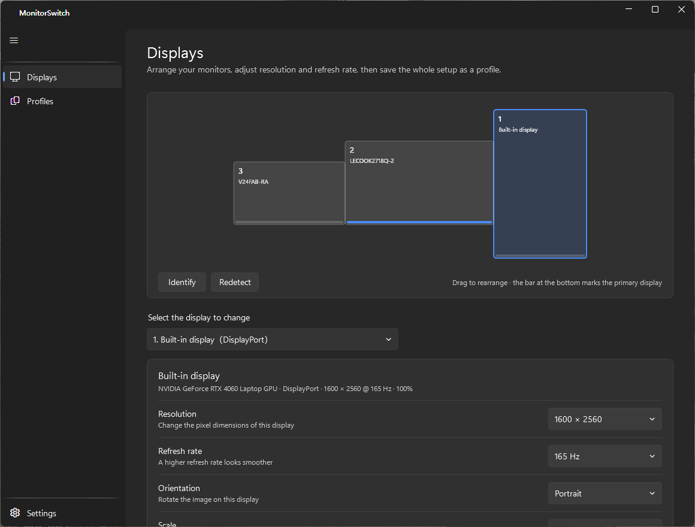
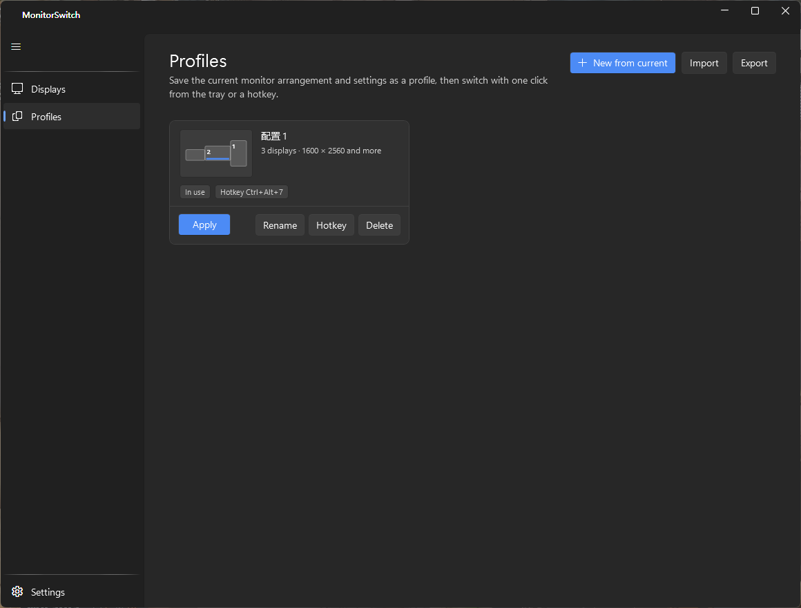
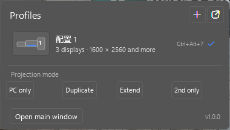
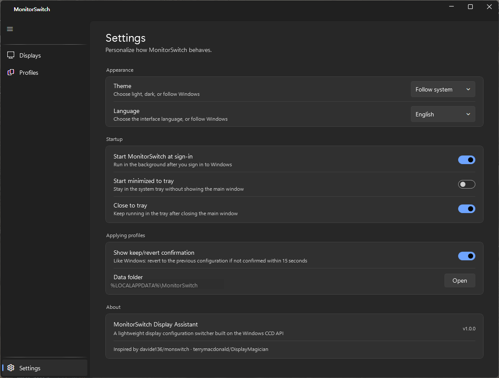

<div align="center">

# MonitorSwitch 显示器助手

**把显示器配置存成模板，一键切回来。**

一款轻量的 Windows 托盘工具：记住你的显示器排列、分辨率、刷新率、方向与 HDR 状态，
之后整套配置瞬间恢复。

[](https://github.com/Introl-ljl/monitor-switch/actions/workflows/build.yml)
[](https://github.com/Introl-ljl/monitor-switch/releases/latest)
[](LICENSE)
[](https://github.com/Introl-ljl/monitor-switch)
[](https://dotnet.microsoft.com/)

[**下载**](https://github.com/Introl-ljl/monitor-switch/releases/latest) · [截图](#截图) · [English](README.md)

</div>

---

多显示器用户往往在固定的几种场景之间来回切换 —— 笔记本单屏办公、桌面双屏、竖屏阅读、
投影观影。Windows 自带的 `Win+P` 只能改拓扑，分辨率和排列每次都要手动重设，
最后总是又打开一遍 Windows 设置。

MonitorSwitch 把整套配置存成一份**模板**。在托盘点一下，或者按一个全局快捷键，
所有设置一次性回来。

## 功能

- **配置模板** —— 把当前的排列、分辨率、刷新率、方向、HDR 与启用状态存成一份命名快照。
- **草稿模式** —— 显示器页的改动只暂存，点「应用」才生效。连续调整多个参数时屏幕不会反复闪烁。
- **15 秒自动还原** —— 与 Windows 一致：应用后屏幕底部出现确认条，未确认则自动回滚。
- **托盘面板** —— 左键点击托盘图标弹出快速切换面板，带迷你排列预览与投影快捷键
  （仅电脑屏幕 / 复制 / 扩展 / 仅第二屏幕）。面板可拖动，并记住你放的位置。
- **全局快捷键** —— 任意模板可绑定 Ctrl/Alt/Shift/Win + 字母、数字或 F1–F24。
- **浅色、深色或跟随系统**，**中文或 English** —— 无需重启即可切换。
- **托盘常驻约 8 MB**。

## 安装

前往 [最新 Release](https://github.com/Introl-ljl/monitor-switch/releases/latest) 下载
`MonitorSwitch-v*-win-x64.exe`。

- 自包含单文件 —— **无需安装 .NET 运行时**，双击即用。
- 首次启动会解压到临时目录，需数秒；之后启动更快。
- 未做代码签名，SmartScreen 可能提示未知发布者 → 「更多信息 → 仍要运行」。

> 需要 Windows 10 1809+ 或 Windows 11。

## 截图

### 显示器

拖动显示器调整排列（带边缘吸附与防重叠），下方调整选中显示器的参数。



> 所有改动都先暂存为草稿。顶部提示条会一直显示，直到你点「应用」——
> 这样连续调整多个设置时屏幕不会闪烁。

### 配置模板



### 托盘面板



### 设置



## 使用

1. 把显示器调成你想要的状态（Windows 设置，或本工具的显示器页）。
2. 到 **配置模板** → **从当前配置新建**。
3. 之后随时从托盘面板或全局快捷键切回来。

### 命令行

```powershell
MonitorSwitch.exe              # 正常启动
MonitorSwitch.exe --minimized  # 只驻留托盘，不显示主窗口
```

### 数据位置

`%LOCALAPPDATA%\MonitorSwitch\`

| 文件 | 内容 |
|---|---|
| `profiles.json` | 配置模板 |
| `settings.json` | 应用设置 |
| `log.txt` | 运行日志（超过 256 KB 自动清空） |

配置文件损坏时会备份为 `*.corrupt-<时间戳>` 并逐条抢救，不会静默清空。

## 构建

需要 [.NET 8 SDK](https://dotnet.microsoft.com/download/dotnet/8.0)：

```powershell
dotnet build src/MonitorSwitch/MonitorSwitch.csproj -c Release
dotnet run --project src/MonitorSwitch/MonitorSwitch.csproj
```

打包成与 Release 一致的单文件：

```powershell
dotnet publish src/MonitorSwitch/MonitorSwitch.csproj `
  -c Release -r win-x64 --self-contained true `
  -p:PublishSingleFile=true `
  -p:IncludeNativeLibrariesForSelfExtract=true `
  -p:EnableCompressionInSingleFile=true `
  -p:DebugType=none -o publish
```

## 技术实现

这个项目几乎所有的难点都来自 Windows 显示子系统的细节。以下几条值得记录，
因为都很容易踩错。

### CCD API

`QueryDisplayConfig` / `SetDisplayConfig` / `DisplayConfigGetDeviceInfo` 负责拓扑、
源/目标模式、时序与 HDR（`SET_ADVANCED_COLOR_STATE`）。
`EnumDisplaySettingsExW` 枚举各显示器支持的分辨率与刷新率；
`EnumDisplayDevicesW` 提供显卡与监视器友好名。

### 自适应结构体步长

`DISPLAYCONFIG_MODE_INFO` 在不同 Windows 版本中大小不同（本机 Windows 11 实测 **64 字节**，
`pixelRate` 与 `hSyncFreq` 在首个 dword 处重合）。程序以原始字节缓冲区 + 运行时步长检测处理，
兼容新旧系统。

### 旋转与源模式

CCD 的源模式**始终以面板原生朝向表示**。90°/270° 旋转时桌面宽高互换 ——
竖屏 2560×1600 面板的源模式是 2560×1600，而桌面占用为 1600×2560。
程序同时保存面板朝向（`SourceWidth/Height`）与桌面朝向（`DesktopWidth/Height`），
下发前在两者之间换算。

### 目标时序有效性

只有当已存的目标时序（`pixelRate` / `vSync` / `activeSize`）仍与系统当前为该路径选中的
时序一致时才复用它；否则由系统按新的分辨率/刷新率重新选择。
这是经典的「改分辨率静默失效」问题的根因。

### 压低托盘占用

常驻专用工作集约 **8 MB**。做到这点踩了几个坑：

| 问题 | 原因 | 处理 |
|---|---|---|
| 常驻 128 MB | WPF 的 `HwndSource` 是渲染宿主，创建即初始化 D3D 管线并加载显卡驱动模块（约 126 MB） | 改用纯 Win32 消息窗口（`RegisterClassEx` + `HWND_MESSAGE`）—— 托盘场景不需要任何渲染能力 |
| +24 MB | WPF-UI 资源字典会实例化整套控件模板 | 延迟到首次显示窗口时才加载 |
| +5.7 MB | `App.xaml` 引用 `ui:FontIcon` 会在启动阶段拉入 `Wpf.Ui.dll` | 该样式改为随其它资源一起延迟注册 |
| +11 MB | `System.Drawing.Common` 连带拉入 `windows.storage.dll` 等模块 | 托盘图标改用 `LoadImage` |

注意 `Shell_NotifyIcon` 本身会加载 `windows.storage.dll`（8.7 MB）—— 托盘图标无法避免。

主窗口显示过一次之后，内存不会回到 8 MB：WPF 的 D3D 管线是进程级状态，无法卸载。

### UI 渲染

- **不用 ClearType。** 子像素渲染会在字形边缘画出彩色条纹。深色背景 + 中文小字号时
  非常明显 —— 实测单像素绿色偏移最高 +75，36.8% 的文字像素带色偏。
  改用灰度抗锯齿后降到 0%。
- **覆盖强调色。** 若系统强调色是低饱和度色（例如青灰 `#69797E`），
  WPF-UI 由它派生的每个画刷都会给 UI 染色。注意 `ApplicationAccentColorManager.Apply`
  **不会**更新 `AccentButtonBackground`，该资源必须直接写入。

## 已知限制

- **缩放百分比为只读。** Windows 没有公开的按显示器 DPI API。程序读取
  `HKCU\Control Panel\Desktop\PerMonitorSettings\<monitorId>\DpiValue`
  （`0` = 100%，`+1` = 125%，`-1` = 75%）。修改请用 Windows 设置。
- **显卡名**取自 GDI 适配器友好名。CCD 的 `DISPLAYCONFIG_ADAPTER_NAME` 只返回设备路径
  （`\\?\PCI#...`）。
- **无 EDID 名称的显示器**（部分内置屏、采集卡）会显示为「内置显示屏」，取决于驱动上报的信息。
- **投影快捷键**依赖系统已保存的拓扑记录，首次使用某模式可能需先在 Windows 设置中配置一次。
- 主窗口打开过一次后，内存不会回落到约 8 MB（见上文）。

## 贡献

欢迎提交 Issue 与 PR，请先阅读 [CONTRIBUTING.md](CONTRIBUTING.md)。

涉及显示配置的改动**必须在真实多显示器环境验证**。这类 bug 往往看起来成功，
实际什么也没做。

## 许可证

[MIT](LICENSE)

## 参考

- [davide136/monswitch](https://github.com/davide136/monswitch)
- [terrymacdonald/DisplayMagician](https://github.com/terrymacdonald/DisplayMagician)
- [CCD APIs — Microsoft Learn](https://learn.microsoft.com/en-us/windows-hardware/drivers/display/ccd-apis)
- [WinUI 3 / Fluent Design](https://learn.microsoft.com/en-us/windows/apps/winui/winui3/)
- [WPF-UI (lepoco)](https://wpfui.lepo.co/)
